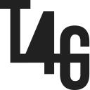
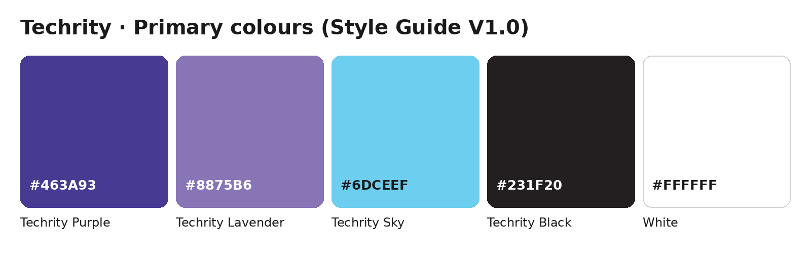

# Techrity Brand System

Official brand assets for **Techrity Innovation Foundation**, a tech non-profit building pathways into technology and opportunity for young Africans.

> **One ecosystem. Multiple entry points. Continuous progression.**

Brand colour: `#463A93` · Website: [techrity.org](https://techrity.org) · X / Instagram: [@techrityorg](https://x.com/techrityorg) · Email: hello@techrity.org

This repository holds the **parent brand (Techrity)** at the root. The **child brands** that have their own visual identity sit under [`brands/`](brands/). Everything at the root applies to Techrity and to every programme without its own identity: Young, Bold & Digital, Kickstart, the Techrity Mentorship Program, Internship, Community, Alumni, Build for Social Good, the Techrity Accelerator, Go-to-Market, the Opportunity Board and Made Circle.

---

## Brand Family

| Level | Brand | Role in the ecosystem | Primary colour | Assets |
|-------|-------|-----------------------|----------------|--------|
| **Parent** |  **Techrity** | Parent brand: owns the mission, credibility, ecosystem story, partnerships, impact and governance |  `#463A93` | this folder |
| Child |  **Tech for Good** | The **Amplify** stage: Techrity's flagship annual conference |  `#884BFF` | [brands/tech-for-good](brands/tech-for-good/) |
| Child |  **Made For Good** | Techrity's CSR, merch and storytelling movement (formerly MerchByTechrity) |  `#421196` | [brands/made-for-good](brands/made-for-good/) |

**Rules across the family**
- Programmes without a child folder use the **parent** system. Name the programme, but don't give it its own logo or palette.
- The **Techrity logo** appears on every Techrity and Tech for Good piece. In a co-brand row the order is **Techrity → T4G → Made For Good**.
- Formal letters for any programme, including Tech for Good partner and speaker invitations, use the **Techrity letterhead**.
- Child palettes stay with their child brand. Every CSS variable is prefixed by brand (`--techrity-`, `--t4g-`, `--m4g-`) so they can't be mixed up. Note that the T4G guide's "Techrity Purple" (`#884BFF`) is a **Tech for Good** colour, not the parent's `#463A93`.

---

## Logo System

The mark is a helping hand, for charity, inside an upward angle bracket, for code. The wordmark **techrity** is always lowercase. All files are exact vectors from the official logo master.

### Lock-up (Logomark + Wordmark)

| Preview | Name | Use on | Download |
|---------|------|--------|----------|
|  | Techrity Lock-up (Purple) | White and light backgrounds | [SVG](logos/svg/lockup/Techrity_Lockup_Purple.svg) · [PNG](logos/png/lockup/Techrity_Lockup_Purple.png) |
|  | Techrity Lock-up (Lavender) | White and light backgrounds | [SVG](logos/svg/lockup/Techrity_Lockup_Lavender.svg) · [PNG](logos/png/lockup/Techrity_Lockup_Lavender.png) |
|  | Techrity Lock-up (Black) | Blue, white and grey backgrounds | [SVG](logos/svg/lockup/Techrity_Lockup_Black.svg) · [PNG](logos/png/lockup/Techrity_Lockup_Black.png) |
|  | Techrity Lock-up (White) | Purple, dark and photo backgrounds | [SVG](logos/svg/lockup/Techrity_Lockup_White.svg) · [PNG](logos/png/lockup/Techrity_Lockup_White.png) |

### Logomark

| Preview | Name | SVG | PNG |
|---------|------|-----|-----|
|  | Techrity Logomark (Purple) | [SVG](logos/svg/logomark/Techrity_Logomark_Purple.svg) | [64](logos/png/logomark/Techrity_Logomark_Purple_64px.png) · [128](logos/png/logomark/Techrity_Logomark_Purple_128px.png) · [256](logos/png/logomark/Techrity_Logomark_Purple_256px.png) · [512](logos/png/logomark/Techrity_Logomark_Purple_512px.png) |
|  | Techrity Logomark (Lavender) | [SVG](logos/svg/logomark/Techrity_Logomark_Lavender.svg) | [64](logos/png/logomark/Techrity_Logomark_Lavender_64px.png) · [128](logos/png/logomark/Techrity_Logomark_Lavender_128px.png) · [256](logos/png/logomark/Techrity_Logomark_Lavender_256px.png) · [512](logos/png/logomark/Techrity_Logomark_Lavender_512px.png) |
|  | Techrity Logomark (Black) | [SVG](logos/svg/logomark/Techrity_Logomark_Black.svg) | [64](logos/png/logomark/Techrity_Logomark_Black_64px.png) · [128](logos/png/logomark/Techrity_Logomark_Black_128px.png) · [256](logos/png/logomark/Techrity_Logomark_Black_256px.png) · [512](logos/png/logomark/Techrity_Logomark_Black_512px.png) |
|  | Techrity Logomark (White) | [SVG](logos/svg/logomark/Techrity_Logomark_White.svg) | [64](logos/png/logomark/Techrity_Logomark_White_64px.png) · [128](logos/png/logomark/Techrity_Logomark_White_128px.png) · [256](logos/png/logomark/Techrity_Logomark_White_256px.png) · [512](logos/png/logomark/Techrity_Logomark_White_512px.png) |

**Usage:** use the full lock-up in most cases, and the logomark alone only for avatars, favicons and small marks. Keep at least **16px** of clear space. The guide shows scales of 100%, 65% and 25%. Don't add shadows, stretch, rearrange, or recolour outside the palette.

---

## Color Palette

### Primary Palette
The four primary colours plus white, from the Techrity Style Guide V1.0. Black is the wordmark colour on blue, white and grey backgrounds.

[](public/Techrity_Colour_Palette.png)

| Swatch | Name | Hex | RGB | Use |
|--------|------|-----|-----|-----|
|  | Techrity Purple | `#463A93` | 70, 58, 147 | Primary: backgrounds, headings, logo. White text 8.9:1 |
|  | Techrity Lavender | `#8875B6` | 136, 117, 182 | Logo and soft panels. White text 4.0:1, so 24px and up only |
|  | Techrity Sky | `#6DCEEF` | 109, 206, 239 | Accent fill, or highlight text on purple (4.9:1). Never use as text on white |
|  | Techrity Black | `#231F20` | 35, 31, 32 | Wordmark and body text. 16.3:1 on white |
|  | White | `#FFFFFF` | 255, 255, 255 | Backgrounds; text and logo on purple |

### Supporting Colours (seen in decks, not in the style guide)

| Swatch | Name | Hex | RGB | Use |
|--------|------|-----|-----|-----|
|  | Ink | `#323232` | 50, 50, 50 | Body text on white (12.8:1) |
|  | Slate | `#6275A2` | 98, 117, 162 | Secondary text on white (4.6:1) |
|  | Violet | `#736EB1` | 115, 110, 177 | Letterhead footer panel |
|  | Lavender Tint | `#BFBBDA` | 191, 187, 218 | Wave ribbon and soft shapes; secondary text on purple (4.8:1) |
|  | Black | `#000000` | 0, 0, 0 | Letterhead bands |

> `#8C87B8` appears as a large subtitle colour on purple in the 2024 Year in Review, but it reaches only 2.6:1 on purple, so don't use it for new text.

---

## Typography System

| Font | Use Case | Source |
|------|----------|--------|
| **Now** | The official typeface for all official writing and marketing assets | Licensed. Font files aren't in this repo yet; see [fonts/](fonts/) |
| **Poppins** | Working fallback, used across current decks and social designs | [Google Fonts](https://fonts.google.com/specimen/Poppins) |

The style guide's hierarchy sets tracking at 0 everywhere, with leading of **Headline 52pt · Subtitle 21pt · Body 12pt**. On 1920 × 1080 slides, body text is 22px and never smaller than 17px.

---

## Design Tokens

| File | Contents |
|------|----------|
| [`design-tokens/techrity.tokens.json`](design-tokens/techrity.tokens.json) | Colours (light and purple themes), type styles, spacing and radius, each with a usage note |
| [`design-tokens/techrity.css`](design-tokens/techrity.css) | CSS custom properties `--techrity-*`, theme selectors `[data-techrity-theme="light|purple"]`, and type classes `.techrity-*` |

```html
<link rel="stylesheet" href="design-tokens/techrity.css">
<section data-techrity-theme="purple" style="background:var(--techrity-surface);color:var(--techrity-ink)">…</section>
```

---

## Messaging

- **Framework line:** From Early Exposure to Digital Access. From Skills to Opportunity. From Talent to Products. From Products to Impact.
- **Ecosystem stages:** Inspire (Young, Bold & Digital) → Equip (Kickstart) → Develop (Techrity Mentorship Program) → Connect (Internship, Community, Alumni) → Build (Build for Social Good) → Accelerate (Techrity Accelerator) → Launch (Go-to-Market) → Amplify (Tech for Good Conference) → Give Back
- **Five content narratives:** People · Progress · Products & Building · Ecosystem · System & Impact. Lead with progression and outcomes, not reach numbers.
- **Voice:** warm and collective ("we", "our community"), concrete (numbers and dates), and crediting partners and mentors by name.

---

## Brand Guidelines

[📄 Techrity Brand Guidelines V1.0 (PDF)](public/Techrity_Brand_Guidelines_V1.0.pdf): logo, scaling, grid, usage, do's and don'ts, typography and primary colours. Positioning and messaging follow Techrity's 2026 ecosystem direction, which supersedes the 2021 guide's mission and programme wording.

---

## Repository Layout

```
techrity-brand-system/
├── README.md                    # Parent brand: Techrity
├── logos/                       # Parent logos
│   ├── svg/
│   │   ├── lockup/              # Logomark + wordmark (Purple, Lavender, Black, White)
│   │   └── logomark/            # Mark only
│   └── png/
│       ├── lockup/              # 1200px wide
│       └── logomark/            # 64, 128, 256, 512px
├── fonts/                       # Font notes (Now is licensed; Poppins fallback)
├── design-tokens/               # techrity.tokens.json + techrity.css (--techrity-*)
├── public/                      # Brand Guidelines V1.0 PDF, palette board, previews/
└── brands/                      # Child brands: each mirrors the parent's layout
    ├── tech-for-good/           # T4G: logos, elements, gradients, design-tokens, public
    └── made-for-good/           # M4G: logos, patterns, applications, design-tokens, public
```

---

## License

Code and design tokens (`design-tokens/`, `*.css`, `*.tokens.json`) are MIT licensed. Logos, brand marks, guideline PDFs, artwork and photography are © Techrity Innovation Foundation, all rights reserved, and may be used only as their brand guidelines describe. See [LICENSE.md](LICENSE.md).
