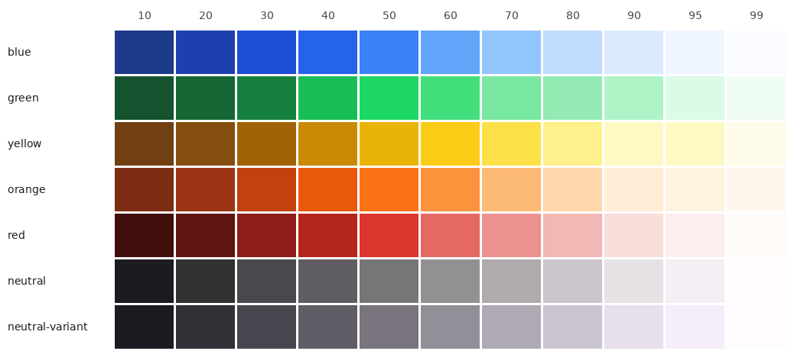
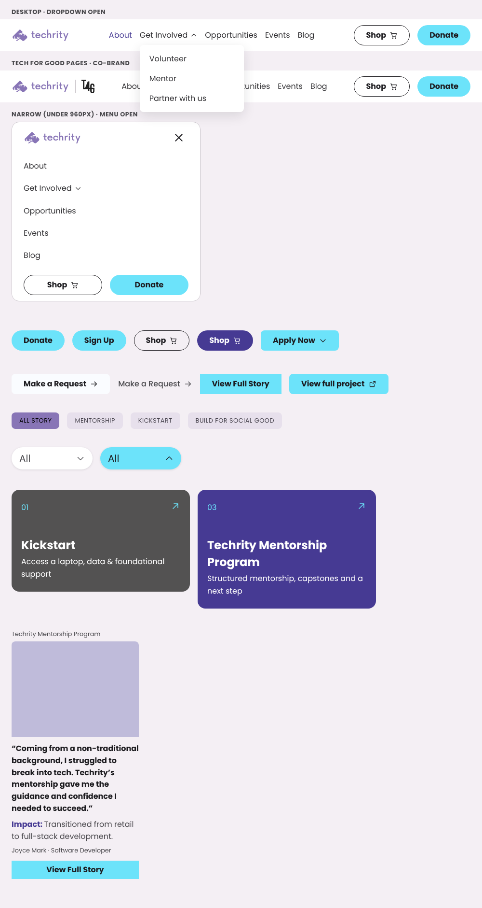

# Techrity Brand System

Official brand assets for **Techrity Innovation Foundation**, a tech non-profit building pathways into technology and opportunity for young Africans.

> **One ecosystem. Multiple entry points. Continuous progression.**

Brand colour: `#463A93` · Website: [techrity.org](https://techrity.org) · X / Instagram: [@techrityorg](https://x.com/techrityorg) · Email: hello@techrity.org

This repository holds the **parent brand (Techrity)** at the root. The **child brands** that have their own visual identity sit under [`brands/`](brands/). Everything at the root applies to Techrity and to every programme without its own identity: Young, Bold & Digital, Kickstart, the Techrity Mentorship Program, Internship, Community, Alumni, Build for Social Good, the Techrity Accelerator, Go-to-Market, the Opportunity Board and Made Circle.

---

## Brand Family

| Level | Brand | Role in the ecosystem | Primary colour | Assets |
|-------|-------|-----------------------|----------------|--------|
| **Parent** |  **Techrity** | Parent brand: owns the mission, credibility, ecosystem story, partnerships, impact and governance |  `#463A93` | this folder |
| Child |  **Tech for Good** | The **Amplify** stage: Techrity's flagship annual conference |  `#884BFF` | [brands/tech-for-good](brands/tech-for-good/) |
| Child |  **Made For Good** | Techrity's CSR, merch and storytelling movement (formerly MerchByTechrity) |  `#421196` | [brands/made-for-good](brands/made-for-good/) |

**Rules across the family**
- Programmes without a child folder use the **parent** system. Name the programme, but don't give it its own logo or palette.
- The **Techrity logo** appears on every Techrity and Tech for Good piece. In a co-brand row the order is **Techrity → T4G → Made For Good**.
- Formal letters for any programme, including Tech for Good partner and speaker invitations, use the **Techrity letterhead**.
- Child palettes stay with their child brand. Every CSS variable is prefixed by brand (`--techrity-`, `--t4g-`, `--m4g-`) so they can't be mixed up. Note that the T4G guide's "Techrity Purple" (`#884BFF`) is a **Tech for Good** colour, not the parent's `#463A93`.

---

## Logo System

The mark is a helping hand, for charity, inside an upward angle bracket, for code. The wordmark **techrity** is always lowercase. All files are exact vectors from the official logo master.

### Lock-up (Logomark + Wordmark)

| Preview | Name | Use on | Download |
|---------|------|--------|----------|
|  | Techrity Lock-up (Purple) | White and light backgrounds | [SVG](logos/svg/lockup/Techrity_Lockup_Purple.svg) · [PNG](logos/png/lockup/Techrity_Lockup_Purple.png) |
|  | Techrity Lock-up (Lavender) | White and light backgrounds | [SVG](logos/svg/lockup/Techrity_Lockup_Lavender.svg) · [PNG](logos/png/lockup/Techrity_Lockup_Lavender.png) |
|  | Techrity Lock-up (Black) | Blue, white and grey backgrounds | [SVG](logos/svg/lockup/Techrity_Lockup_Black.svg) · [PNG](logos/png/lockup/Techrity_Lockup_Black.png) |
|  | Techrity Lock-up (White) | Purple, dark and photo backgrounds | [SVG](logos/svg/lockup/Techrity_Lockup_White.svg) · [PNG](logos/png/lockup/Techrity_Lockup_White.png) |

### Logomark

| Preview | Name | SVG | PNG |
|---------|------|-----|-----|
|  | Techrity Logomark (Purple) | [SVG](logos/svg/logomark/Techrity_Logomark_Purple.svg) | [64](logos/png/logomark/Techrity_Logomark_Purple_64px.png) · [128](logos/png/logomark/Techrity_Logomark_Purple_128px.png) · [256](logos/png/logomark/Techrity_Logomark_Purple_256px.png) · [512](logos/png/logomark/Techrity_Logomark_Purple_512px.png) |
|  | Techrity Logomark (Lavender) | [SVG](logos/svg/logomark/Techrity_Logomark_Lavender.svg) | [64](logos/png/logomark/Techrity_Logomark_Lavender_64px.png) · [128](logos/png/logomark/Techrity_Logomark_Lavender_128px.png) · [256](logos/png/logomark/Techrity_Logomark_Lavender_256px.png) · [512](logos/png/logomark/Techrity_Logomark_Lavender_512px.png) |
|  | Techrity Logomark (Black) | [SVG](logos/svg/logomark/Techrity_Logomark_Black.svg) | [64](logos/png/logomark/Techrity_Logomark_Black_64px.png) · [128](logos/png/logomark/Techrity_Logomark_Black_128px.png) · [256](logos/png/logomark/Techrity_Logomark_Black_256px.png) · [512](logos/png/logomark/Techrity_Logomark_Black_512px.png) |
|  | Techrity Logomark (White) | [SVG](logos/svg/logomark/Techrity_Logomark_White.svg) | [64](logos/png/logomark/Techrity_Logomark_White_64px.png) · [128](logos/png/logomark/Techrity_Logomark_White_128px.png) · [256](logos/png/logomark/Techrity_Logomark_White_256px.png) · [512](logos/png/logomark/Techrity_Logomark_White_512px.png) |

**Usage:** use the full lock-up in most cases, and the logomark alone only for avatars, favicons and small marks. Keep at least **16px** of clear space. The guide shows scales of 100%, 65% and 25%. Don't add shadows, stretch, rearrange, or recolour outside the palette.

---

## Color Palette

### Primary Palette
The four primary colours plus white, from the Techrity Style Guide V1.0. Black is the wordmark colour on blue, white and grey backgrounds.

[](public/Techrity_Colour_Palette.png)

| Swatch | Name | Hex | RGB | Use |
|--------|------|-----|-----|-----|
|  | Techrity Purple | `#463A93` | 70, 58, 147 | Primary: backgrounds, headings, logo. White text 8.9:1 |
|  | Techrity Lavender | `#8875B6` | 136, 117, 182 | Logo and soft panels. White text 4.0:1, so 24px and up only |
|  | Techrity Sky | `#6DCEEF` | 109, 206, 239 | Accent fill, or highlight text on purple (4.9:1). Never use as text on white |
|  | Techrity Black | `#231F20` | 35, 31, 32 | Wordmark and body text. 16.3:1 on white |
|  | White | `#FFFFFF` | 255, 255, 255 | Backgrounds; text and logo on purple |

### Supporting Colours (seen in decks, not in the style guide)

| Swatch | Name | Hex | RGB | Use |
|--------|------|-----|-----|-----|
|  | Ink | `#323232` | 50, 50, 50 | Body text on white (12.8:1) |
|  | Slate | `#6275A2` | 98, 117, 162 | Secondary text on white (4.6:1) |
|  | Violet | `#736EB1` | 115, 110, 177 | Letterhead footer panel |
|  | Lavender Tint | `#BFBBDA` | 191, 187, 218 | Wave ribbon and soft shapes; secondary text on purple (4.8:1) |
|  | Black | `#000000` | 0, 0, 0 | Letterhead bands |

> `#8C87B8` appears as a large subtitle colour on purple in the 2024 Year in Review, but it reaches only 2.6:1 on purple, so don't use it for new text.

---

## Typography System

| Font | Use Case | Source |
|------|----------|--------|
| **FF Mark Pro** (`"Mark Pro"`) | The official typeface for brand, print **and web/product UI**. It replaces Now, which Brand Guide V1.0 specified | Commercial (FontFont). Licensed files are **not** in this repo; see [fonts/](fonts/) |
| **Poppins** | Fallback wherever Mark Pro isn't installed; used across current decks and social designs | [Google Fonts](https://fonts.google.com/specimen/Poppins) |

Mark Pro weights: Hairline 250 · Thin 275 · ExtraLight 300 · Light 350 · Regular 400 · Book 450 · Medium 500 · Bold 700 · Heavy 800 · Black 900, each with an italic, and no 600. Load [`fonts/mark-pro.css`](fonts/mark-pro.css) before `design-tokens/techrity.css`.

The style guide's hierarchy sets tracking at 0 everywhere, with leading of **Headline 52pt · Subtitle 21pt · Body 12pt**. On 1920 × 1080 slides, body text is 22px and never smaller than 17px.

---

## Web & Product UI

Techrity's web UI kit (website, Opportunity Board and dashboards) adds a product layer to the parent brand. It applies to Techrity and to every programme that uses the parent system. Tech for Good and Made For Good keep their own palettes. The Figma exports are in [`public/ui-kit/`](public/ui-kit/).

### UI Colours

| Swatch | Name | Hex | Token | Use |
|--------|------|-----|-------|-----|
|  | UI Cyan | `#6CE3FA` | `--techrity-ui-cyan` | Primary buttons (Donate, Sign Up, Apply Now). Use **dark text only**: `neutral-10` is 11.4:1, while white is 1.5:1 |
|  | UI Gray | `#535252` | `--techrity-ui-gray` | Default card fill, with white text (7.8:1) |
|  | Brand Purple | `#463A93` | `--techrity-brand-purple` | Active cards and links, and the hover state |
|  | Brand Lavender | `#8875B6` | `--techrity-brand-lavender` | Web logo and active filter chips |

UI Cyan is a brighter screen version of Brand Sky (`#6DCEEF`), and the two stay separate tokens.

### Tonal Palettes (UI states only)

[](public/ui-kit/Techrity_UI_Tonal_Palettes.png)

There are seven palettes in tones 10 to 99 (`--techrity-{blue,green,yellow,orange,red,neutral,neutral-variant}-{10…99}`).
- **Blue** is for action and info; `blue-40` is also the focus ring.
- **Green** is for success, **yellow** for caution, **orange** for warning and **red** for errors (`red-40`).
- **Neutrals** are for text, surfaces and outlines.

Their values match Tailwind CSS (blue, green, yellow, orange) and the Material 3 baseline (red, neutral). Use them for states, never as brand colours.

### UI Type, Grid and Icons

- **Typeface:** **FF Mark Pro**, the same family as the brand (`--techrity-font-sans`: `"Mark Pro", "FF Mark Pro", Poppins, system-ui`).

| Level | Desktop | Mobile (< 744px) | Class |
|-------|---------|------------------|-------|
| H1 | 60px | 40px | `.techrity-ui-h1` |
| H2 | 46px | 32px | `.techrity-ui-h2` |
| H3 | 32px | 24px | `.techrity-ui-h3` |
| H4 | 24px | 20px | `.techrity-ui-h4` |
| H5 | 20px | 18px | `.techrity-ui-h5` |
| H6 | 16px | 16px | `.techrity-ui-h6` |

  - Headings are Bold by default, with Black (900) for emphasis. The `.techrity-ui-h*` classes switch to the mobile sizes on their own below 744px.
  - **Weights:** Mark Pro has ten weights, but **no Semi-Bold**. The kit's Semi-Bold column maps to Medium (500) or Bold (700), and the components use Bold.
  - Desktop sizes are measured from the 1× kit export and rounded. The mobile scale is a recommendation, because the kit leaves it open.
- **Body scale:** 25 · 24 · 22 · 20 · **16 (default)** · 12.8px (`.techrity-ui-paragraph-*`). Keep UI text on these steps, so no 14px.
- **Grid:** an **8-point grid** with **12 columns** (`--techrity-grid-1…8`, 8–64px).
  - Mobile frame: 24px status bar · 48px nav · content · 48px action bar · 38px home indicator.
  - Breakpoints (the kit's frame widths): Desktop **2048** · Desktop/Laptop **1920** · Laptop **1440** · Tablet **1024** / **744** · Mobile **428**px, recorded as `--techrity-bp-*` for reference.
- **Radii:** cards 16px, controls 8px, nav actions pill.
- **Icons:** [Phosphor Icons](https://phosphoricons.com) (MIT). Use the Regular weight, and Fill for selected states.

### Components

[](public/ui-kit/Techrity_UI_Components_Rendered.png)

| Component | Guide | What it is |
|-----------|-------|------------|
| Button | [Button.md](ui-kit/components/Button.md) | primary (cyan) · outline · purple · ghost · link, in pill, rounded or square shapes |
| Tag | [Tag.md](ui-kit/components/Tag.md) | Story and category filter chip |
| FilterSelect | [FilterSelect.md](ui-kit/components/FilterSelect.md) | "All ▾" dropdown trigger |
| NavBar | [NavBar.md](ui-kit/components/NavBar.md) | Site header with Shop and Donate, dropdown menus, a menu button below 960px and an optional T4G co-brand |
| PathwayCard | [PathwayCard.md](ui-kit/components/PathwayCard.md) | Numbered ecosystem entry-point card |
| StoryCard | [StoryCard.md](ui-kit/components/StoryCard.md) | Participant story with an Impact line |

```html
<link rel="stylesheet" href="design-tokens/techrity.css">
<link rel="stylesheet" href="ui-kit/components/techrity-ui.css">
<script src="https://cdn.jsdelivr.net/npm/react@18.3.1/umd/react.production.min.js"></script>
<script src="https://cdn.jsdelivr.net/npm/react-dom@18.3.1/umd/react-dom.production.min.js"></script>
<script src="ui-kit/components/techrity-ui.js"></script>
<script>
  const h = React.createElement, T = window.Techrity;
  ReactDOM.createRoot(document.getElementById('app')).render(h(T.Button, { variant: 'primary' }, 'Donate'));
</script>
```

The components are built for light surfaces (white and `neutral-95`), as the web UI kit is, and don't follow the purple theme. Typed props are in [`techrity-ui.d.ts`](ui-kit/components/techrity-ui.d.ts). Not built yet: the Project Overview modal and the Dashboard Header (see the reference images).

**Fixes made to the kit**
- **Missing sizes:** heading sizes and breakpoint widths weren't labelled in the kit, so they're measured from its frames.
- **Black H1:** the kit draws the Black H1 at H2 size; H1 follows the Semi-Bold and Bold columns.
- **Duplicate yellow:** yellow 95 duplicated yellow 90, so it's now `#FEFCE8`, the next Tailwind step.
- **Contrast:** several kit pairs failed WCAG AA, so the components use passing pairs instead.
  - Inactive tag text `#85828A` (2.6:1) → `neutral-variant-30` (6.3:1)
  - Active tag text (4.3:1) → `black` (5.3:1)
  - Outline-button hover, white on lavender (4.0:1) → white on brand purple (9.2:1)
  - Lavender "Impact:" label (4.0:1) → brand purple

---

## Design Tokens

| File | Contents |
|------|----------|
| [`design-tokens/techrity.tokens.json`](design-tokens/techrity.tokens.json) | Brand colours (light and purple themes), UI colours and tonal palettes, brand and UI type styles, spacing (including the 8-pt grid) and radius, each with a usage note |
| [`design-tokens/techrity.css`](design-tokens/techrity.css) | CSS custom properties `--techrity-*`, theme selectors `[data-techrity-theme="light|purple"]`, and type classes `.techrity-*` (including `.techrity-ui-*`) |

Every brand shares the same six semantic roles (`surface`, `ink`, `heading`, `muted`, `accent` and `hairline`) under its own prefix. Token JSON and CSS for all three brands are generated by [`scripts/gen_tokens.py`](scripts/gen_tokens.py) from the Claude Design System exports, so the repo and the design systems stay in step.

```html
<link rel="stylesheet" href="design-tokens/techrity.css">
<section data-techrity-theme="purple" style="background:var(--techrity-surface);color:var(--techrity-ink)">…</section>
```

---

## Messaging

- **Framework line:** From Early Exposure to Digital Access. From Skills to Opportunity. From Talent to Products. From Products to Impact.
- **Ecosystem stages:** Inspire (Young, Bold & Digital) → Equip (Kickstart) → Develop (Techrity Mentorship Program) → Connect (Internship, Community, Alumni) → Build (Build for Social Good) → Accelerate (Techrity Accelerator) → Launch (Go-to-Market) → Amplify (Tech for Good Conference) → Give Back
- **Five content narratives:** People · Progress · Products & Building · Ecosystem · System & Impact. Lead with progression and outcomes, not reach numbers.
- **Voice:** warm and collective ("we", "our community"), concrete (numbers and dates), and crediting partners and mentors by name.

---

## Brand Guidelines

[📄 Techrity Brand Guidelines V1.0 (PDF)](public/Techrity_Brand_Guidelines_V1.0.pdf): logo, scaling, grid, usage, do's and don'ts, typography and primary colours. Positioning and messaging follow Techrity's 2026 ecosystem direction, which supersedes the 2021 guide's mission and programme wording.

---

## Where the System Lives

The brand system exists in three places. Changes flow one way, so they never disagree:

| Place | What it holds | Role |
|-------|---------------|------|
| **Claude Design Systems** (Techrity · Tech for Good · Made For Good) | Tokens, guidelines, live component previews and assets | **Source of truth.** Edit tokens and guidance here first |
| **This repo** | Token JSON and CSS, UI kit code, logo files, guideline PDFs | Code and file distribution, generated from the design systems |
| **Canva** › *Techrity Design System* folder | Logos, palettes, UI kit references, guidelines as editable designs, plus a subfolder for each child brand | Day-to-day design work for the comms team |

**To change a token:**
1. Edit it in the brand's Claude Design System.
2. Export its `tokens.json` and run `python3 scripts/gen_tokens.py <export> <repo tokens.json> <css> <prefix> "<Brand>"`.
3. Commit the result. The **Check design tokens** workflow (`scripts/check_tokens.py`) blocks the change if:
   - the CSS doesn't match the tokens
   - a brand is missing one of the six semantic roles
   - a text colour fails WCAG AA
   - a token is missing its usage note
4. If a logo or palette changed, re-import it into the Canva folder.

The Canva **Brand Kit** (colours, fonts and logo slots) is set by hand in Canva. Keep it in step with the values above.

---

## Repository Layout

```
techrity-brand-system/
├── README.md                    # Parent brand: Techrity
├── logos/                       # Parent logos
│   ├── svg/
│   │   ├── lockup/              # Logomark + wordmark (Purple, Lavender, Black, White)
│   │   └── logomark/            # Mark only
│   └── png/
│       ├── lockup/              # 1200px wide
│       └── logomark/            # 64, 128, 256, 512px
├── fonts/                       # Font notes + mark-pro.css (@font-face for FF Mark Pro; licensed files stay out of the repo)
├── scripts/                     # gen_tokens.py builds every brand's tokens JSON + CSS; check_tokens.py verifies them
├── .github/workflows/           # check-tokens.yml runs check_tokens.py on every token change
├── design-tokens/               # techrity.tokens.json + techrity.css (--techrity-*)
├── ui-kit/components/           # Web UI components: techrity-ui.{js,css,d.ts} + one guide per component
├── public/                      # Brand Guidelines V1.0 PDF, palette board, previews/, ui-kit/ references
└── brands/                      # Child brands: each mirrors the parent's layout
    ├── tech-for-good/           # T4G: logos, elements, gradients, design-tokens, public
    └── made-for-good/           # M4G: logos, patterns, applications, design-tokens, public
```

---

## License

Code and design tokens (`design-tokens/`, `ui-kit/components/`, `scripts/`, `*.css`, `*.js`, `*.py`, `*.tokens.json`) are MIT licensed. Logos, brand marks, guideline PDFs, artwork and photography are © Techrity Innovation Foundation, all rights reserved, and may be used only as their brand guidelines describe. See [LICENSE.md](LICENSE.md).
