# Made For Good Brand System

> **Child brand of [Techrity](../../README.md).** Made For Good is Techrity's CSR and merch movement and has its own visual identity. It carries Techrity's mission of making talents and its pay-it-forward value. See [How it relates to Techrity](#how-it-relates-to-techrity).

Official brand assets for **Made For Good** (M4G, also written Made4Good / MadeForGood), formerly **MerchByTechrity**. It's a movement celebrating the journeys of African tech professionals: *every techie is MADE, and MADE FOR GOOD.*

Brand colour: `#421196` · Website: [madeforgood.com](https://www.madeforgood.com) · Social: @madeforgood · Taglines: **Do Good. Be Good. Wear Good.**

---

## Logo System

| Preview | Name | Format | Download |
|---------|------|--------|----------|
| 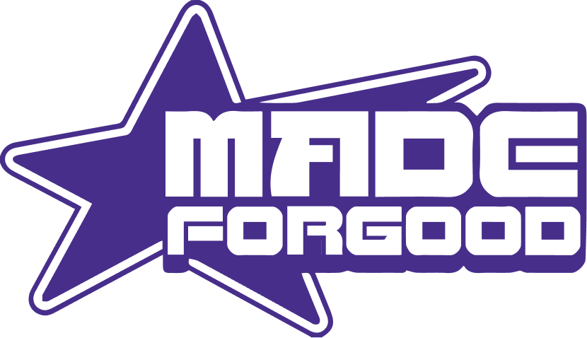 | Made For Good Logo (Colour, ink `#472E8B`) | Official PNG export | [PNG](logos/png/lockup/M4G_Logo_Colour.png) |
| 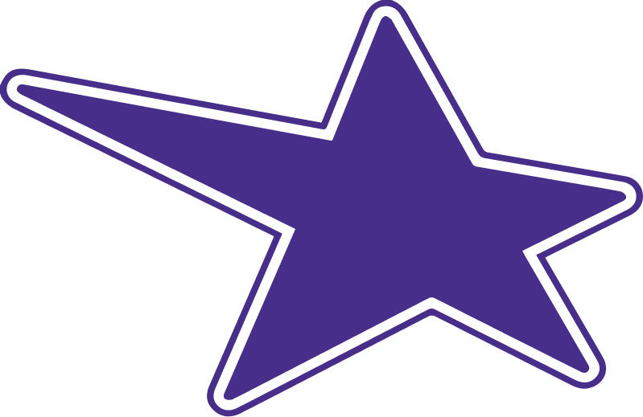 | Made For Good Symbol (shooting star) | Official PNG export | [PNG](logos/png/symbol/M4G_Symbol_Colour.png) |
| 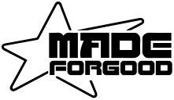 | Made For Good Logo (One-colour line) | **Vector master** | [SVG](logos/svg/M4G_Logo_Mono.svg) |

The star stands for "Celestial Bodies That Shine": a beacon of impact, and growth from raw potential to *having made it*.

**Don'ts** (guideline 1.4): don't change its colours, stretch it, rotate it, add graphics, outline it in black, or use an all-secondary-colour version.

---

## Color Palette

[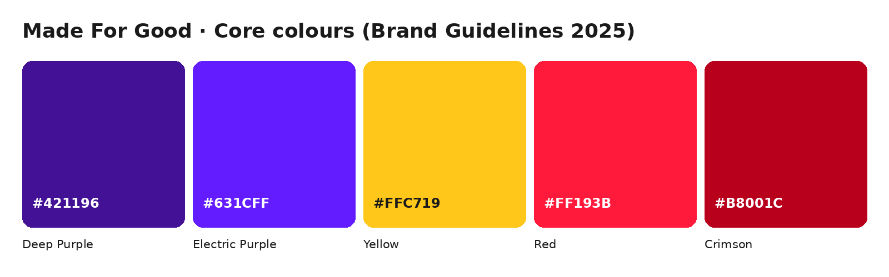](public/M4G_Colour_Palette.png)

### Core Palette
| Swatch | Name | Hex | RGB | Use |
|--------|------|-----|-----|-----|
|  | Deep Purple | `#421196` | 66, 17, 150 | Primary: backgrounds, panels. White text 12.0:1, yellow 7.7:1 |
|  | Electric Purple | `#9529FF` | 149, 41, 255 | Primary accent: section chips, panels. White text 5.2:1. Never as text on deep purple (2.3:1) |
|  | Yellow | `#FFC719` | 255, 199, 25 | Secondary: merch, calls to action. Black or deep-purple text only |
|  | Red | `#FF193B` | 255, 25, 59 | Secondary: posters. White text 3.9:1, so large bold only |
|  | Crimson | `#B8001C` | 184, 0, 28 | Secondary. White text 6.9:1 |
|  | Logo Ink | `#472E8B` | 71, 46, 139 | Logo and symbol only, as in every official export |

Each core colour has a nine-step scale (100–900, where 500 is the base):

[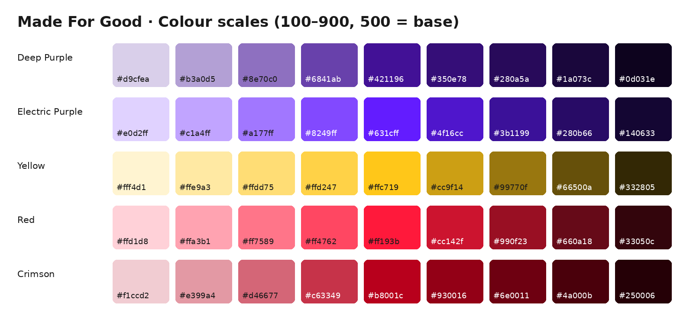](public/M4G_Colour_Scales.png)

> The guideline labels the electric purple swatch "#631CFF", but the swatch and the palette sheet both show `#9529FF`, so that's used here.

---

## Typography System

| Font | Use Case | Source |
|------|----------|--------|
| **Moderniz** | Headlines and packaging, always in caps (96px / 120%) | Commercial. Get the licensed files; not included |
| **Manrope** | Sub-headlines (48px), captions (24px) and body (16px), all at 120% line height; weights 300–700 | [Google Fonts](https://fonts.google.com/specimen/Manrope) |

---

## Patterns

| Preview | Pattern | Download |
|---------|---------|----------|
| 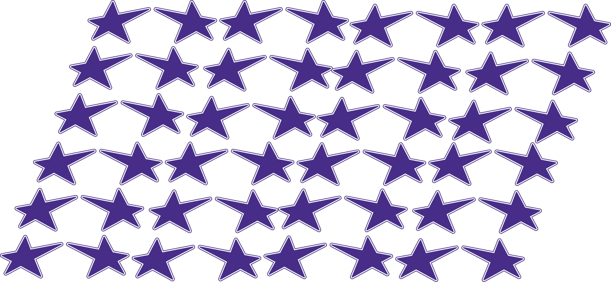 | Star field ("Celestial Bodies That Shine") | [PNG](patterns/M4G_Pattern_Stars.png) |
| 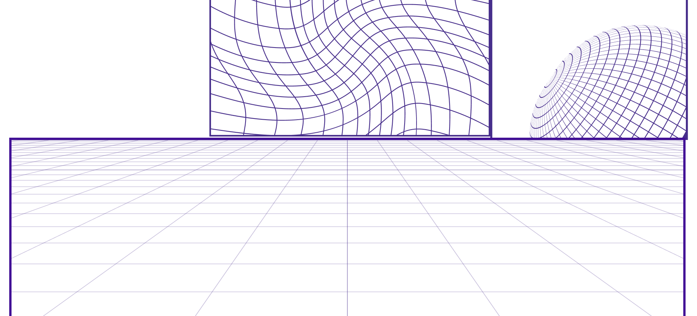 | Grids: warped grid, dotted sphere, perspective floor ("born from nebulae") | [PNG](patterns/M4G_Pattern_Grids.png) |

## Applications

<a href="applications/M4G_Billboard.jpg">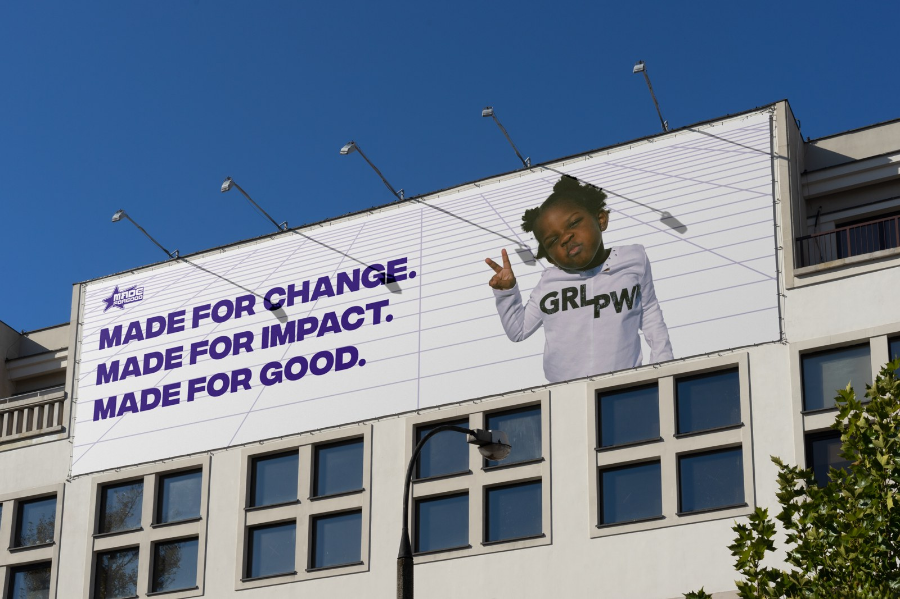</a> <a href="applications/M4G_Business_Card_Front.jpg">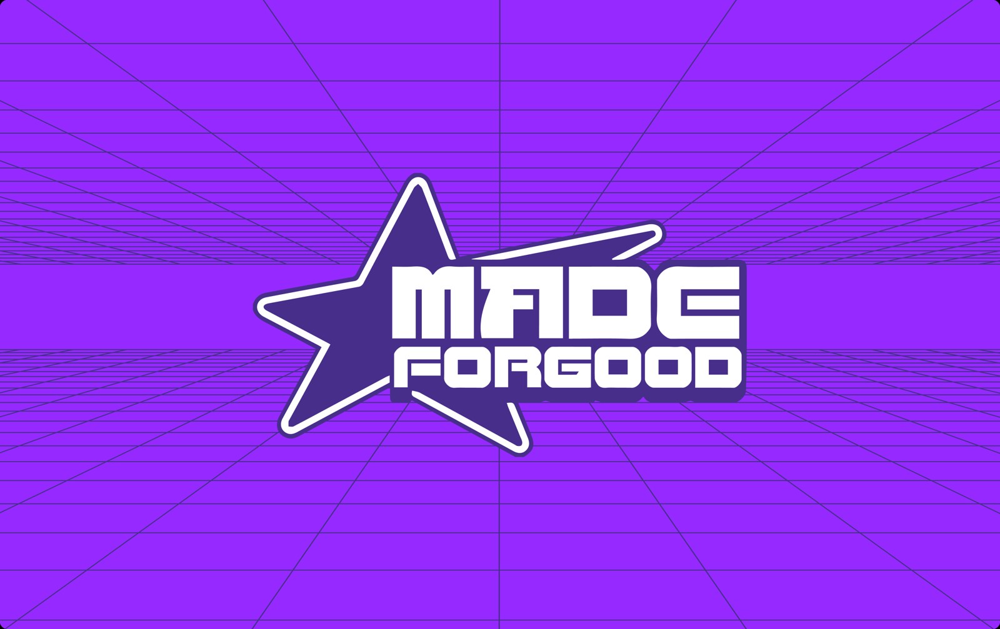</a> <a href="applications/M4G_Letterhead.jpg">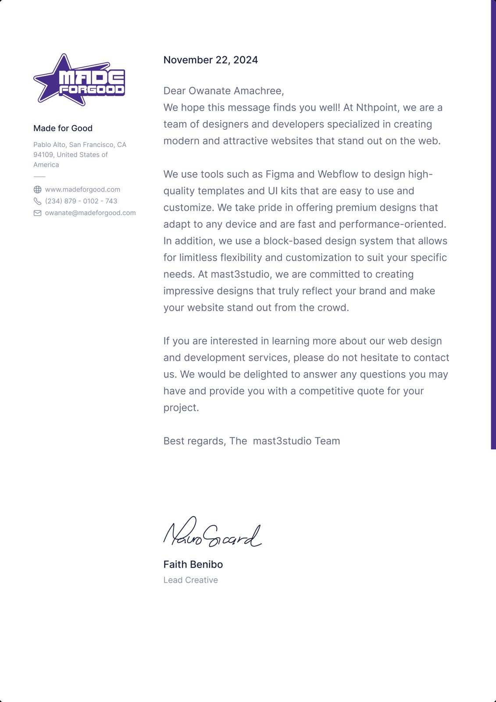</a> <a href="applications/M4G_Post_New_Ideas.jpg">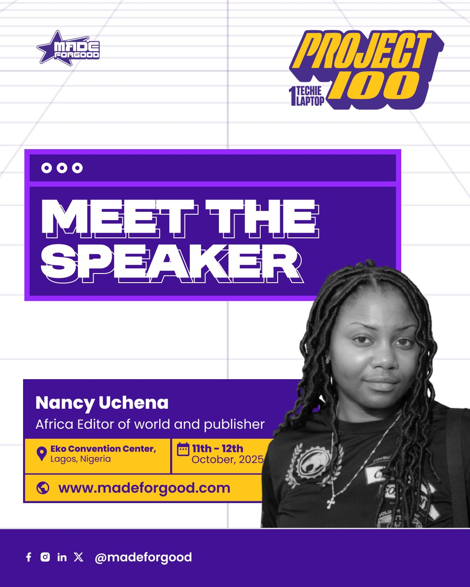</a> <a href="applications/M4G_Post_Project_100.jpg">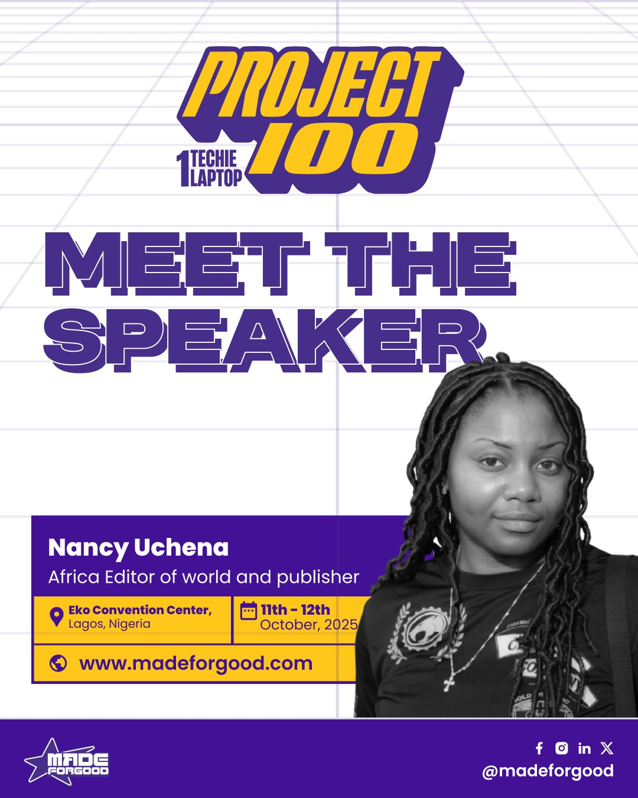</a> <a href="applications/M4G_Post_So_Much_Good.jpg">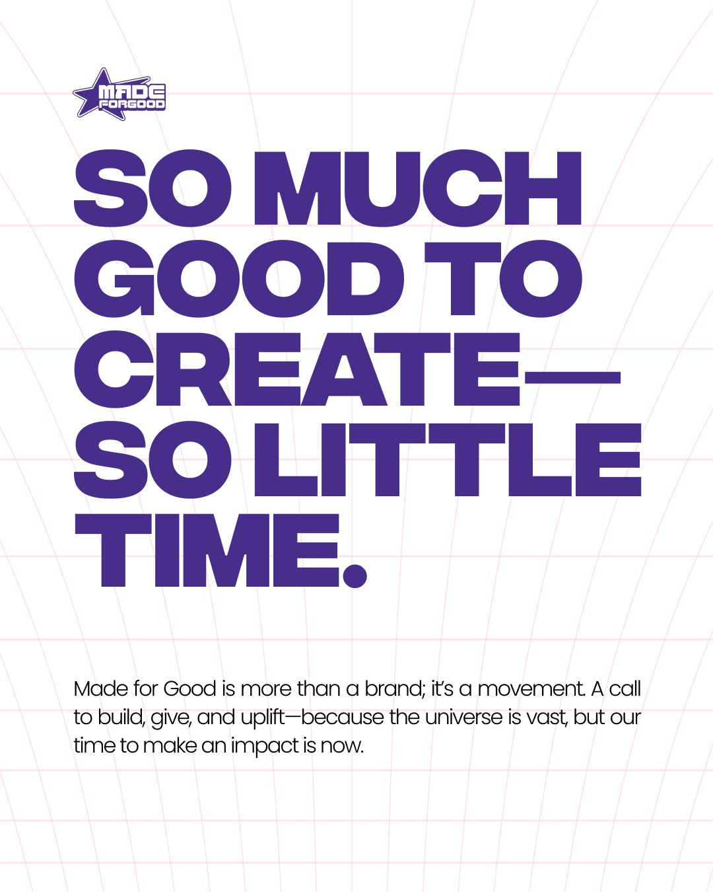</a> <a href="applications/M4G_Post_Women_Who_Create.jpg">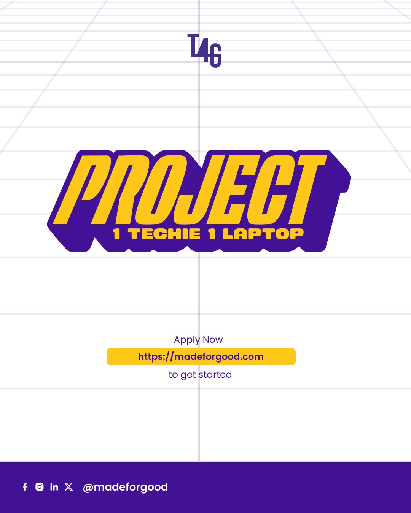</a> <a href="applications/M4G_Story_Made_For_Change.jpg">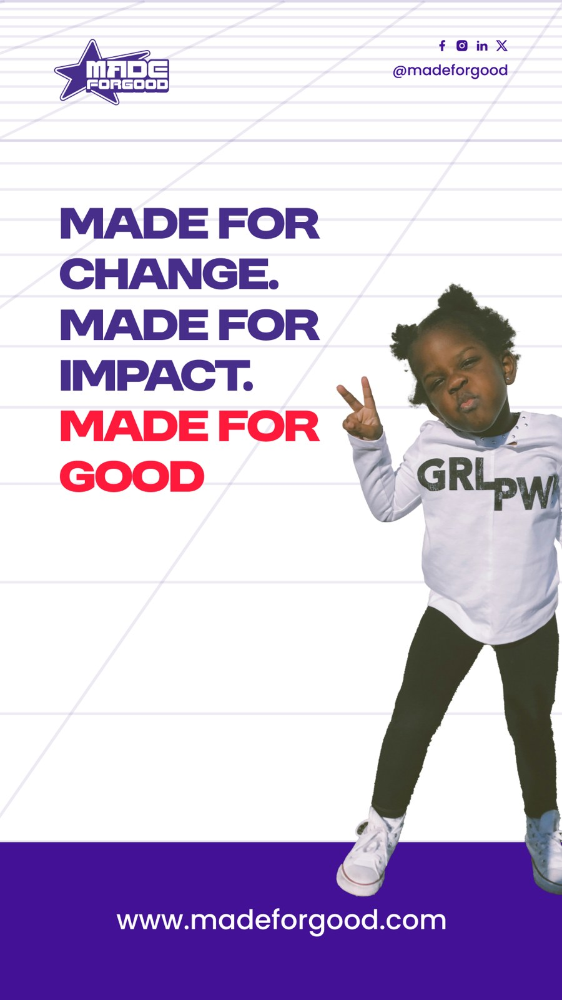</a> <a href="applications/M4G_Tee_Tech_Bro.jpg">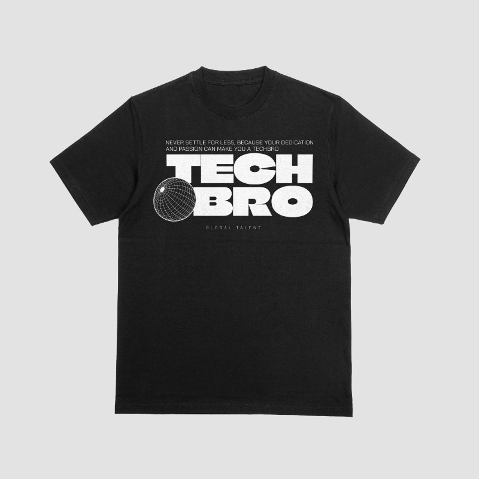</a>

The social post layout: logo top left, @madeforgood and socials top right, a grid or star motif, a Moderniz headline, and a deep-purple footer bar with www.madeforgood.com.

---

## Design Tokens

| File | Contents |
|------|----------|
| [`design-tokens/made-for-good.tokens.json`](design-tokens/made-for-good.tokens.json) | Colours with full scales (purple and light themes, including the family-wide `hairline` role), Moderniz and Manrope hierarchy, spacing and radius |
| [`design-tokens/made-for-good.css`](design-tokens/made-for-good.css) | `--m4g-*` variables, `[data-m4g-theme="purple|light"]`, `.m4g-*` type classes |

---

## How it relates to Techrity

| Inherited from the parent | Own to Made For Good |
|---------------------------|----------------------|
| Mission: helping new talents into tech, read here as *making* talents | Star logo, palette and scales |
| The pay-it-forward core value and Give Back culture | Moderniz + Manrope |
| Purchases fund mentorship, data support and laptops (e.g. **Project 100: 1 Techie, 1 Laptop**) | madeforgood.com, @madeforgood, #MadeForGood #MadeStars #MadeChamps |
| Appears after Techrity and T4G in co-brand rows | Its own layouts: no Techrity logo inside Made For Good layouts |

**Not the same as Made Circle.** Made Circle is Techrity's paid community for founders and senior professionals and uses the **parent** brand.

---

## Brand Guidelines

- [📄 Made For Good Brand Guidelines 2025 (PDF)](public/Made_For_Good_Brand_Guidelines_2025.pdf): **current**. It covers the logo, mission, typography, colour, patterns, social media and mockups.
- [📄 MerchByTechrity's New Brand Identity: MadeForGood (PDF)](public/MerchByTechrity_New_Brand_Identity_MadeForGood.pdf): why the rename happened, taglines, products and touchpoints
- [📄 Made4Good Messaging (PDF)](public/Made4Good_Messaging.pdf): the "From Merch to Movement" narrative and core expressions (MadePodcast, MadeMerch, MadeSeries)

---

## Folder Layout

```
brands/made-for-good/
├── logos/
│   ├── svg/                    # M4G_Logo_Mono.svg (vector master, one-colour)
│   └── png/{lockup,symbol}/    # Official colour exports
├── patterns/                   # Star field, grids
├── applications/               # Approved 2025 designs (stationery, merch, social, OOH)
├── design-tokens/              # made-for-good.tokens.json + .css (--m4g-*)
└── public/                     # Guideline PDFs, palette and scale boards
```

## License

Code and design tokens (`design-tokens/`, `*.css`, `*.tokens.json`) are MIT licensed. Logos, brand marks, guideline PDFs, artwork and photography are © Techrity Innovation Foundation, all rights reserved, and may be used only as their brand guidelines describe. See [LICENSE.md](../../LICENSE.md).
