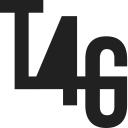
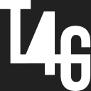
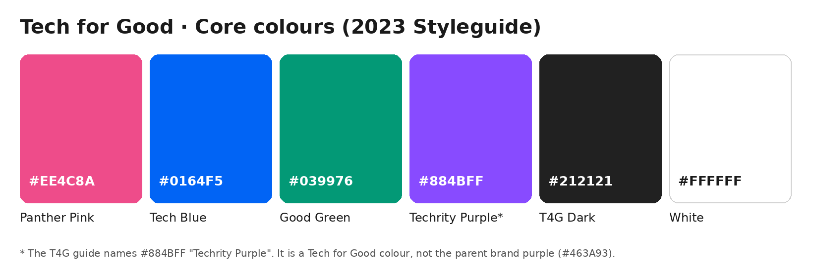
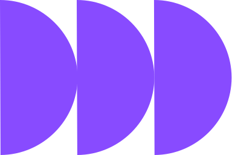
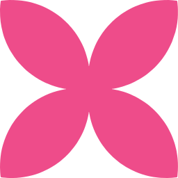
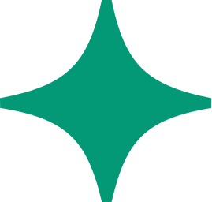
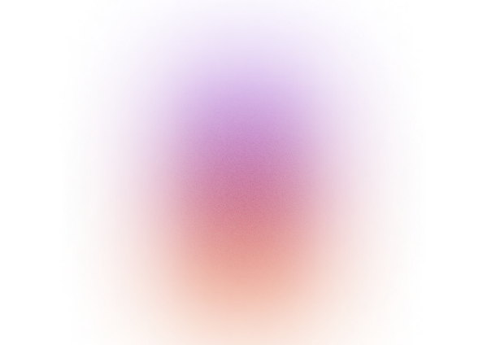

# Tech for Good Brand System

> **Child brand of [Techrity](../../README.md).** Tech for Good is the **Amplify** stage of the Techrity ecosystem. Techrity's logo, letterhead, contact details and #techrity tag still apply. See [How it relates to Techrity](#how-it-relates-to-techrity).

Official brand assets for **Tech for Good** (T4G), Techrity's flagship annual conference. It brings students, professionals, founders, creatives and public-sector leaders together to explore how digital innovation can solve real problems in Africa.

Brand colour: `#884BFF` · Tickets: [t4g.techrity.org](https://t4g.techrity.org/) · Tags: #techforgood #techrity · Enquiries: hello@techrity.org

Editions: **2.0** (2022) · **3.0** (21 Oct 2023) · **4.0** (25 Oct 2025, Port Harcourt, "AI Impact Africa", Techrity's 5th Anniversary Edition)

---

## Logo System

### Logomark

| Preview | Name | SVG | PNG |
|---------|------|-----|-----|
|  | T4G Logomark (Dark `#212121`) | [SVG](logos/svg/logomark/T4G_Logomark_Dark.svg) | [128](logos/png/logomark/T4G_Logomark_Dark_128px.png) · [256](logos/png/logomark/T4G_Logomark_Dark_256px.png) · [512](logos/png/logomark/T4G_Logomark_Dark_512px.png) |
|  | T4G Logomark (White) | [SVG](logos/svg/logomark/T4G_Logomark_White.svg) | [128](logos/png/logomark/T4G_Logomark_White_128px.png) · [256](logos/png/logomark/T4G_Logomark_White_256px.png) · [512](logos/png/logomark/T4G_Logomark_White_512px.png) |

The mark is a condensed, overlapping **T 4 G**. Set the edition caption beneath it in Source Code Pro (e.g. "Tech For Good 3.0"). The vectors are the exact paths from the 2023 styleguide. On posters, the Techrity lock-up sits top left and the T4G mark top right.

---

## Color Palette

[](public/T4G_Colour_Palette.png)

### Core Palette (2023 Styleguide)
| Swatch | Name | Hex | RGB | Use |
|--------|------|-----|-----|-----|
|  | Panther Pink | `#EE4C8A` | 238, 76, 138 | X element, labels, bullets. White text 3.5:1, so large bold only |
|  | Tech Blue | `#0164F5` | 1, 100, 245 | Flower element, big headlines on white (5.1:1) |
|  | Good Green | `#039976` | 3, 153, 118 | Star element. White text 3.6:1, so large only |
|  | Techrity Purple* | `#884BFF` | 136, 75, 255 | >>> chevrons, CTA blocks, banner panels. White text 4.7:1 |
|  | T4G Dark | `#212121` | 33, 33, 33 | Dark backgrounds, T4G mark, text on light |
|  | White | `#FFFFFF` | 255, 255, 255 | Light backgrounds, text and elements on dark |

\* The T4G guide names `#884BFF` "Techrity Purple". It's a **Tech for Good** colour, not the parent's `#463A93`. In CSS it's `--t4g-techrity-purple`.

### 4.0 Campaign Extras (2025)
| Swatch | Name | Hex | RGB | Use |
|--------|------|-----|-----|-----|
|  | Navy | `#1E1333` | 30, 19, 51 | Footer bars, CTA cards. White text 17.6:1 |
|  | Lilac | `#CCA5FF` | 204, 165, 255 | Highlight words on navy or dark |
|  | Deep Purple | `#3D0C8C` | 61, 12, 140 | Ticket and ribbon shapes |
|  | Periwinkle | `#BDB2FF` | 189, 178, 255 | Billboard and screen panels |
|  | Sky | `#74CCF0` | 116, 204, 240 | Contact-info box |
|  | Mist | `#F4ECFF` | 244, 236, 255 | Light top wash on posters |

---

## Typography System

| Font | Use Case | Source |
|------|----------|--------|
| **Anton** | Numbers, headers and sub-headers, in caps: "TECH FOR GOOD CONFERENCE 2023" | [Google Fonts](https://fonts.google.com/specimen/Anton) |
| **Source Code Pro** | Body text and taglines: "Get Ready To Show Off Your Innovative Ideas!" | [Google Fonts](https://fonts.google.com/specimen/Source+Code+Pro) |

---

## Elements

| Preview | Element | Meaning | Colour | Download |
|---------|---------|---------|--------|----------|
|  | >>> chevrons | Year 3, forward progress | `#884BFF` | [SVG](elements/svg/T4G_Element_Chevrons.svg) · [PNG](elements/png/T4G_Element_Chevrons.png) |
|  | Four-petal X | The Hackathon, from <> brackets | `#EE4C8A` | [SVG](elements/svg/T4G_Element_X.svg) · [PNG](elements/png/T4G_Element_X.png) |
|  | Four-point star | The "4", four circles: wholeness and completeness | `#039976` | [SVG](elements/svg/T4G_Element_Star.svg) · [PNG](elements/png/T4G_Element_Star.png) |
|  | Flower | "Good", four hearts: charity, love, care and support | `#0164F5` | [SVG](elements/svg/T4G_Element_Flower.svg) · [PNG](elements/png/T4G_Element_Flower.png) |

Strips: [Colour on light](elements/svg/T4G_Elements_Colour.svg) · [White on dark](elements/svg/T4G_Elements_White.svg). Repeat them as the edge border on flyers, banners and posters.

## Gradient Theme

   

T4G Gradients 01–04: lavender waves · violet to peach · lavender to pink · blue to green. Use them as soft, grainy backgrounds behind Anton titles.

---

## Design Tokens

| File | Contents |
|------|----------|
| [`design-tokens/tech-for-good.tokens.json`](design-tokens/tech-for-good.tokens.json) | Colours (light and dark themes), Anton and Source Code Pro styles, spacing and radius |
| [`design-tokens/tech-for-good.css`](design-tokens/tech-for-good.css) | `--t4g-*` variables, `[data-t4g-theme="light|dark"]`, `.t4g-*` type classes |

---

## How it relates to Techrity

| Inherited from the parent | Own to Tech for Good |
|---------------------------|----------------------|
| Techrity lock-up on every piece (top left on posters; first in the co-brand row) | T4G mark, edition captions |
| Techrity letterhead for partner, sponsor and speaker letters | Core palette and 4.0 extras |
| hello@techrity.org, @techrityorg, techrity.org, #techrity | Anton + Source Code Pro |
| Mission, ecosystem story, five content narratives | Elements, gradient theme, bloom-strip border |

---

## Brand Guidelines

- [📄 Tech for Good Conference 2023 Brand Styleguide V2 (PDF)](public/T4G_Brand_Styleguide_2023_V2.pdf): **current**
- [📄 TechForGood 2.0 Branding Proposal, 2022 (PDF)](public/TechForGood_2.0_Branding_Proposal_2022.pdf): **historical, superseded**

---

## Folder Layout

```
brands/tech-for-good/
├── logos/{svg,png}/logomark/   # T4G_Logomark_Dark / _White
├── elements/{svg,png}/         # Four elements + colour and white strips
├── gradients/                  # T4G_Gradient_01–04
├── design-tokens/              # tech-for-good.tokens.json + .css (--t4g-*)
└── public/                     # Styleguide PDFs, palette board
```

## License

Code and design tokens (`design-tokens/`, `*.css`, `*.tokens.json`) are MIT licensed. Logos, brand marks, guideline PDFs, artwork and photography are © Techrity Innovation Foundation, all rights reserved, and may be used only as their brand guidelines describe. See [LICENSE.md](../../LICENSE.md).
